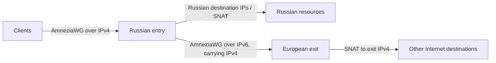

**awg-cascade** provisions and manages a two-VPS AmneziaWG VPN. Clients connect to a stable Russian IPv4 entry. Russian destination IP ranges exit there; other IPv4 traffic crosses an AmneziaWG tunnel over public IPv6 and exits through the European VPS's IPv4 address.



IPv6 rotation changes the interserver endpoint and its transport source. Client profiles keep the same entry endpoint and keys. Foreign traffic fails closed if the exit tunnel disappears. The European private resolver supplies DNS; client Internet IPv6 is captured and blocked.

The controller needs Python 3.10+, Bash and a recent OpenSSH client. The supported server baseline is **Ubuntu 24.04 LTS with systemd**, native IPv4/IPv6, and matching `x86_64` or `aarch64` architectures. The exit must have an explicitly allocated IPv6 `/64`. A dedicated entry and an exit with existing Docker/Xray are supported; Docker is optional and is not installed by this project. See [bootstrapping](docs/BOOTSTRAP.md) for the complete requirements.

Start by copying and editing the public example configuration:

```sh
cp examples/cascade.example.json config.local.json
# Edit config.local.json with your real VPS addresses and SSH settings.
./bootstrap.sh --config config.local.json --plan
```

The example uses documentation-only IP addresses. `--plan` makes no SSH connections and does not read credential files. This prepared checkout also has an ignored `config.local.json` containing the original deployment's public settings and password-file paths. Its `clients: []` preserves existing client names without requesting additional profiles. It contains no passwords or VPN keys. Review it before connecting to the servers.

Then run a read-only server preflight, followed by provisioning:

```sh
./bootstrap.sh --config config.local.json --check --accept-new-host-keys
./bootstrap.sh --config config.local.json --profiles-dir .local/profiles
```

`--accept-new-host-keys` trusts first-seen SSH host keys and records them in `.local/known_hosts`; changed keys are still rejected. Alternatively, verify and populate that file yourself and omit the flag. Password files are optional; SSH keys/agent and passwordless sudo are supported. Bootstrap installs packages and project services, builds pinned official sources on the exit, and transfers checksummed binaries to the entry. It never automatically reboots either VPS.

On an existing compatible installation, a rerun keeps server keys, client keys/profiles, shared obfuscation settings and the active rotated IPv6 address. Client names in the configuration are additive. Inconsistent state, missing keys, unrelated interface/route collisions, and implicit address/port/MTU migrations are rejected rather than overwritten. `--restart` explicitly restarts project tunnel services after installation; existing Docker/Xray is not restarted.

After installation, run on the entry:

```sh
sudo cascadectl health
sudo cascadectl client add phone-04
sudo cascadectl rotate
sudo cascadectl backup
```

Import a separate generated `.conf` file on each AmneziaWG 3.1-compatible device. Android's **Always-on VPN** and **Block connections without VPN** settings provide blocking while disconnected.

| File or directory | Purpose |
|---|---|
| `bootstrap.sh`, `bootstrap.py` | Controller entry point and orchestration |
| `bin/cascadectl` | Self-contained installed management command |
| `lib/` | Strict configuration, native SSH transport, root-side installation actions |
| `config/versions.json` | Exact upstream tags and commit IDs |
| `examples/cascade.example.json` | Public, editable deployment schema |
| `systemd/`, `templates/` | Reviewable service definitions and private DNS configuration |
| `docs/BOOTSTRAP.md` | Installation, SSH authentication, reruns and recovery |
| `docs/USAGE.md` | Client management, rotation, overrides, backups and diagnostics |
| `docs/ARCHITECTURE.md` | Address plan, policy routing, source pinning and failure behavior |
| `docs/TESTING.md` | Local tests and disposable-VPS validation procedure |

Run the local checks with:

```sh
./scripts/check.sh
```

These checks use synthetic keys, isolated temporary files and mocked SSH/kernel commands. They do not contact or modify VPSs. The original routing design was tested with real traffic, blocked-endpoint rollback and reboots; the packaged bootstrap still needs its own disposable-VPS smoke test before use in a new environment.

The existing MIT license is preserved. AmneziaWG Go and tools are fetched from their official repositories and retain their respective upstream licenses. No third-party source or generated credentials are vendored here.
